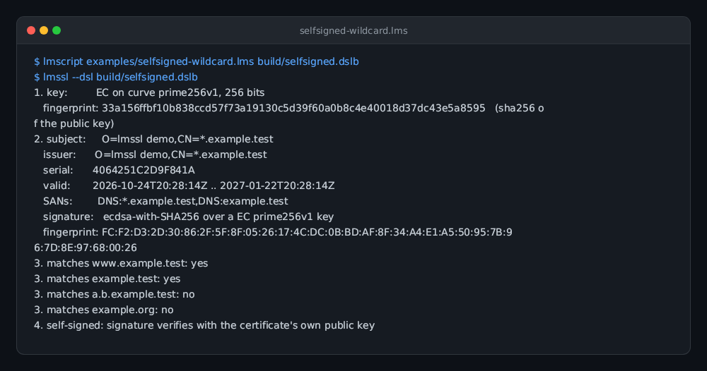
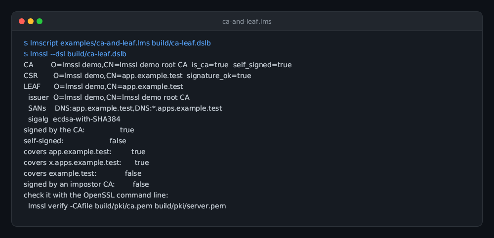
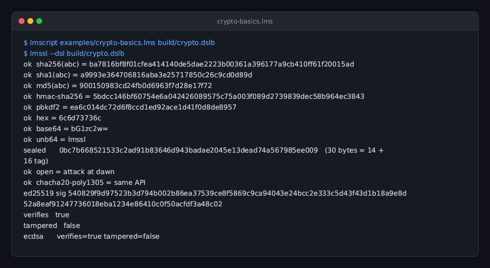
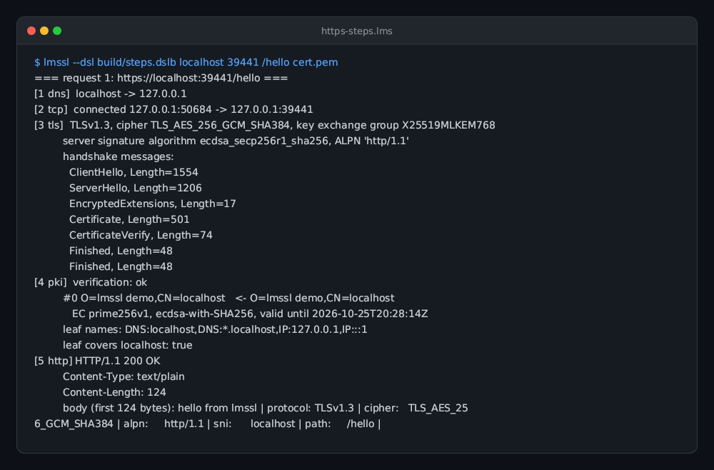
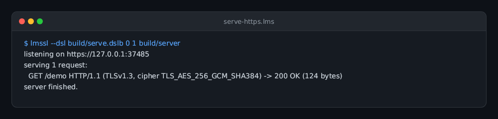
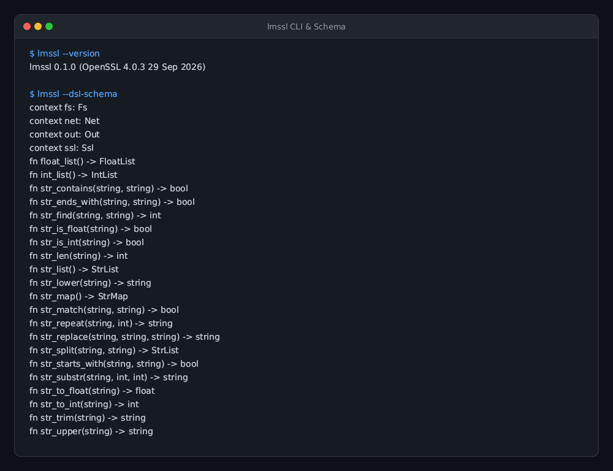

# lmssl

**lmssl is the OpenSSL command line as one static executable, plus a way to script libcrypto and libssl with compiled
[lmscript](https://lmctl.com/tools/lmscript/skill.html) `_dsl_` bytecode.** It exists for understanding: each step of
generating a certificate or making an HTTPS request is one visible call, so you can see what OpenSSL does. It is not a
replacement for `curl`.

```sh
lmssl version                                   # it is openssl: every command, option and exit code is OpenSSL 4.0.3's
lmssl req -x509 -newkey ec -pkeyopt ec_paramgen_curve:P-256 -nodes -keyout key.pem -out cert.pem -subj /CN=demo
lmssl --lmcode build/https-steps.dslb google.com   # run compiled DSL bytecode against the same libraries
```

- **One file, no dependencies.** Linux (glibc static), macOS and Windows binaries are on the
  [releases page](https://github.com/lmctl-ai/lmssl/releases). `ldd lmssl` says "not a dynamic executable".
  OpenSSL's stock `openssl.cnf` is embedded, so `req`, `ca` and friends work on a machine with no OpenSSL installed.
- **Two modes in one binary.** Anything that is not `--lmcode`, `--json`, `--version`, `--lmcode-schema` or `--lmcode-signatures`
  is handed to OpenSSL's own `main` (compiled from the unmodified `apps/openssl.c`, with `main` renamed). `--lmcode FILE`
  loads bytecode, checks it against the schema embedded in the binary, and runs it.
- **Examples that explain.** [`examples/`](examples/) has self-signed wildcard certificates, a small CA, an HTTPS
  request split into DNS / TCP / TLS / PKI / HTTP steps (with the handshake messages printed), and a local HTTPS server.

## Gallery

| **Self-signed wildcard** | **CA & leaf certificate** | **Crypto basics** |
| --- | --- | --- |
|  |  |  |
| EC key and self-signed wildcard certificate with SAN validation.<br>`lmctl https://raw.githubusercontent.com/lmctl-ai/lmssl/main/examples/selfsigned-wildcard.lms` | Root CA, server CSR, signed leaf certificate, and chain verification.<br>`lmctl https://raw.githubusercontent.com/lmctl-ai/lmssl/main/examples/ca-and-leaf.lms` | Digests, HMAC, PBKDF2, AES-256-GCM, ChaCha20-Poly1305, and Ed25519.<br>`lmctl https://raw.githubusercontent.com/lmctl-ai/lmssl/main/examples/crypto-basics.lms` |

| **HTTPS handshake steps** | **Local HTTPS server** | **lmssl CLI & Schema** |
| --- | --- | --- |
|  |  |  |
| DNS, TCP, TLS handshake messages, cipher negotiation, and HTTP response.<br>`lmctl https://raw.githubusercontent.com/lmctl-ai/lmssl/main/examples/https-steps.lms` | Local test HTTPS server with auto-generated certificate serving TLS 1.3.<br>`lmctl https://raw.githubusercontent.com/lmctl-ai/lmssl/main/examples/serve-https.lms` | Embedded OpenSSL 4.0.3 CLI and strongly typed DSL schema signatures.<br>`lmssl --version && lmssl --lmcode-schema` |

## Quick start

```sh
npm install -g @lmctl-ai/lmctl        # provides the lmscript compiler (DSL bytecode v5)
lmscript examples/selfsigned-wildcard.lms build/wildcard.dslb
lmssl --lmcode build/wildcard.dslb build/wildcard
lmssl x509 -in build/wildcard/cert.pem -noout -text | head -30     # inspect the result with the CLI half
```

`https-steps` against a real site:

```sh
lmscript examples/https-steps.lms build/https-steps.dslb
lmssl --lmcode build/https-steps.dslb google.com          # follows google.com -> www.google.com
```

It prints, per request, the DNS answers, the TCP endpoints, the negotiated TLS version / cipher / key-exchange group
(`X25519MLKEM768` on OpenSSL 4), every handshake message with its length, the certificate chain with issuers, the result
of verifying it against the system trust store, and the HTTP status line and headers.

## The DSL

A script is a `_dsl_` block in a normal `.lms` file. The block is a small strongly typed language whose names come from
[`schema/lmssl.dsl.json`](schema/lmssl.dsl.json); lmscript compiles it to bytecode bound to the SHA-256 of that schema, and
`lmssl` refuses bytecode compiled against any other schema before it runs anything.

```
p = _lmcode_ schema="schema/lmssl.dsl.json";
let key = ssl.gen_ec("P-256");
let cert = ssl.new_cert(key, "CN=*.example.test");
cert.san("DNS:*.example.test,DNS:example.test");
cert.valid_days(90);
cert.sign_self(key, "SHA256");
fs.write("cert.pem", cert.pem());
end _lmcode_
savedsl(p, "cert.dslb");
```

`lmssl --lmcode-schema` prints the whole surface (147 signatures); the types are:

| Context | What it is |
| --- | --- |
| `ssl` | version, clock (`now`, `monotonic_us`), encodings, random, digests, HMAC, PBKDF2, AEAD (`seal`/`open`), key generation and loading, certificate / CSR creation and parsing, TLS contexts |
| `net` | `resolve`, `connect`, `listen`, `timeout` |
| `fs`, `out` | files (private keys are written mode 0600), output (`line`, `warn`, `fail`) |

Objects: `Key`, `Cert`, `Csr`, `TlsCtx`, `Tls`, `Conn`, `Listener`, `StrList`. `Cert` is a builder (`san`, `ca`, `ext`,
`valid_days`, `sign_self`, `sign_with`) and an inspector (`subject`, `issuer`, `not_after`, `san_text`, `matches_host`,
`fingerprint`, `text`, ...). `TlsCtx` is the client or server policy (`min_version`, `alpn`, `ciphers`, `suites`, `groups`,
`ca_file`, `system_roots`, `client_cert`, `require_client`, `trace`); `connect` / `accept` perform the handshake and return a `Tls`.

Exit codes: `0` ok, `2` compile error (lmscript), `3` load refused or host error (bad bytecode, schema mismatch,
handshake failure, ...), `4` the script called `out.fail`. With `--json`, stdout carries exactly one JSON result line and
script output goes to stderr.

## Build

```sh
scripts/sync-openssl.sh      # shallow-clones the OpenSSL tag pinned in openssl.lock into third_party/openssl
./test.sh                    # configures, builds (OpenSSL first: a few minutes), and runs all checks
```

Needs `lmscript` >= 0.2.420, `cmake` >= 3.24, a C/C++17 toolchain, `perl`, `make`, and `lmscript` for the tests. The result is `build/lmssl`.
Design notes are in [`durable-memory/`](durable-memory/index.md).

## License

Apache-2.0, the same license as OpenSSL 3 and later (see [`LICENSE`](LICENSE)); third-party notices are in
[`THIRD_PARTY_NOTICES.md`](THIRD_PARTY_NOTICES.md).
